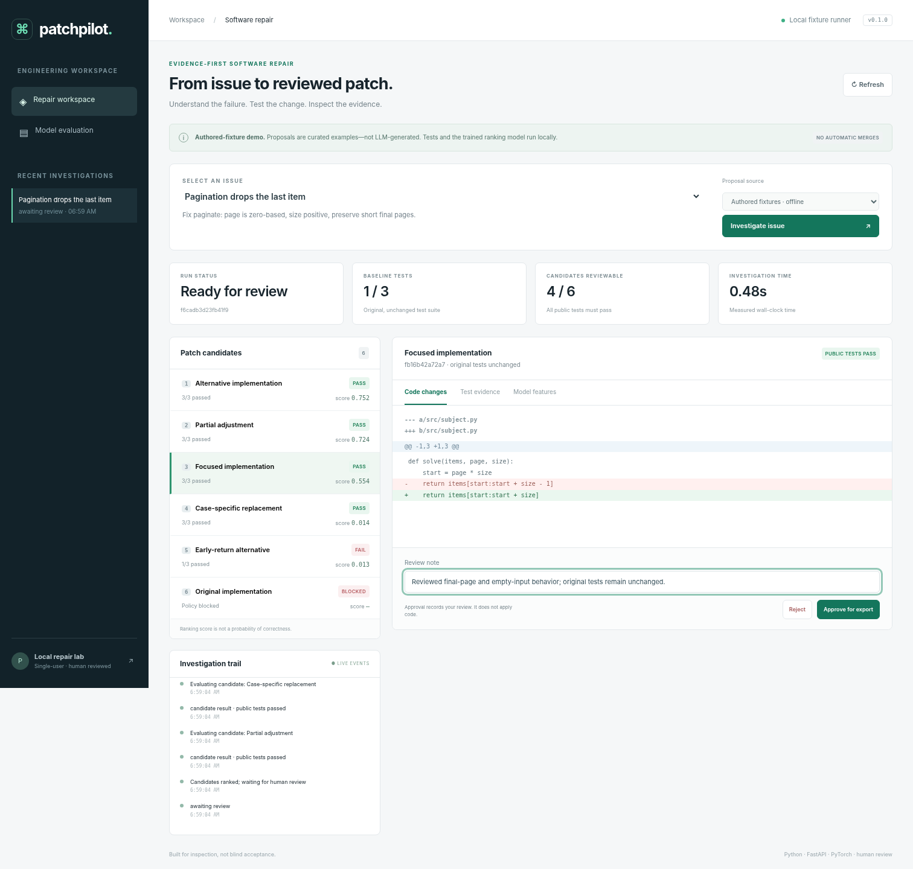

# PatchPilot

**Investigate a bug. Compare tested repairs. Keep the final decision.**

PatchPilot is a local, single-user software-repair workbench that combines a
bounded coding-agent integration, disposable test workspaces, a learned patch
ranker, and an evidence-first review interface. The initial scope is **small
Python repositories with standard-library `unittest` suites**.



*Screenshot: the bundled no-build dashboard, driven by the real backend through
a test transport bridge. The independent Next.js frontend is in `frontend/`.*

## What this release actually does

| Capability | Implementation |
|---|---|
| Code inspection | Bounded file listing, AST symbol summaries, lexical retrieval, line-numbered reads |
| Live patch generation | Optional OpenAI Responses API tool loop with tool/turn/token budgets and explicit source-sharing consent |
| Offline experience | 24 original repair tasks and authored candidate proposals; **not disguised LLM output** |
| Verification | Source-hash preconditions, protected tests, syntax checks, immutable originals, disposable candidate workspaces |
| Execution | Trusted-fixture host runner; a separate fail-closed Docker runner for live/untrusted proposals |
| Machine learning | Pairwise PyTorch MLP trained on 144 executed candidate patches; JSON weights with lightweight NumPy inference |
| Review | Ranked patches, unified diffs, test logs, feature inspection, review notes, approved `.diff` export |
| Application | FastAPI, SQLite job/event/audit persistence, bearer authentication, event streaming |
| Frontend | Verified no-build JavaScript dashboard; separate React / Next.js / TypeScript source |

**This is not an autonomous production engineer.** It does not push commits,
create pull requests, auto-merge changes, claim SWE-bench results, or execute
arbitrary projects on the host. See [validation](reports/VALIDATION.md) before
interpreting any result.

## Start in five minutes

Use Python 3.11+ from a source checkout. The model artifact is included; no GPU,
paid API, Node.js, or Docker is needed for the offline fixture workflow.

```bash
python3 -m venv .venv
source .venv/bin/activate
python -m pip install -e ".[dev]"
python scripts/setup.py
python -m patchpilot.cli serve
```

Windows PowerShell activation: `.\.venv\Scripts\Activate.ps1`.

Open **http://127.0.0.1:8000**, enter the locally generated API token, choose an
issue, and click **Investigate issue**. Compare a focused implementation with a
case-specific patch: both may pass public tests, but that does not establish
correctness. Inspect the code, write a review note, and export an approved diff.

Tokens and local databases are excluded from Git. Do not share the token in a
screenshot, README, issue, or repository.

### Command-line demonstration

```bash
patchpilot tasks
patchpilot run pagination
```

The JSON output includes measured test outcomes, the candidate-ranking score,
provider provenance, and the explicit limitations of the run.

## Live AI generation

This is opt-in because source excerpts and public test output are transmitted to
the model provider, and generated code must be treated as untrusted.

1. Install Docker and build the runner from the repository root:

   ```bash
   docker build -f sandbox/Dockerfile -t patchpilot-runner:local .
   ```

2. Configure the backend **environment**, not browser-side variables:

   ```bash
   export PATCHPILOT_RUNNER=docker
   export PATCHPILOT_ALLOW_EXTERNAL_LLM=1
   export OPENAI_API_KEY="your-local-key"
   export OPENAI_MODEL="a-tool-capable-model-you-can-access"
   ```

3. Restart the API. Select **Live model**, explicitly consent to source sharing,
   and submit an issue. Or run:

   ```bash
   patchpilot run pagination --provider openai --consent-source-sharing
   ```

There is **no host fallback** when Docker is missing or fails. There is **no demo
fallback** when the model request fails. API adapters have mocked tests; this
release has not been validated with a paid model call or live Docker execution
in the creation environment. See [LIVE_MODE.md](docs/LIVE_MODE.md).

### Use your own small repository

```bash
# Register an explicit snapshot. The original is never modified.
patchpilot register repo-myapp /path/to/myapp --issue-file issue.txt

# Optional: fetch an issue body, without cloning code or performing GitHub writes.
patchpilot github-issue owner/repository 42 --out issue.txt

# After Docker / provider setup:
patchpilot run repo-myapp --provider openai --consent-source-sharing
```

Custom projects need `tests/` containing standard-library `unittest` tests, with
application source importable from the root or `src/`. External dependencies,
package installation, new files, non-Python edits, and multi-language builds are
outside this initial scope. Restricted file types, file-count, size, path, and
credential-name rules apply. Inspect the sanitized snapshot before sharing it.

## The ML experiment

The corpus contains **24 authored repair tasks, six candidate proposals per task,
and 888 executed public/oracle test cases during dataset construction**. These
are small original examples—not scraped GitHub issues or SWE-bench tasks.

The ranker uses **22 selection-time features** from public test outcomes and
source-change structure. It does not receive oracle results, candidate titles,
task identities, or bug-family labels as input. Hidden-to-the-agent tests provide
training/evaluation labels only. Families, rather than individual patches, define
the split: **15 training tasks / 3 validation tasks / 6 test tasks**.

| Method | Top-ranked eligible patch passes oracle tests, held-out tasks |
|---|---:|
| Pairwise neural ranker | 6 / 6 |
| Logistic regression | 6 / 6 |
| Static-only logistic ablation | 6 / 6 |
| Smallest passing patch | 4 / 6 |
| Public-test score, fixed tie order | 2 / 6 |

**The neural model does not beat the simpler logistic baseline here.** The corpus
is deliberately small, and authored overfit patches have recognizable patterns.
These numbers validate the experiment and comparison machinery, not real-world
repair performance. Ranking scores are uncalibrated and are not probabilities of
correctness. The UI never has access to oracle test outcomes.

Reproduce from source:

```bash
python -m pip install -e ".[ml]"
python scripts/make_benchmarks.py
python scripts/build_dataset.py
python scripts/train_ranker.py
```

Training is CPU-sized. Model weights are exported as numeric JSON, not a pickle.
Inference requires NumPy; PyTorch is required only for training and export checks.
Read the [model card](docs/MODEL_CARD.md) and [data card](docs/DATA_CARD.md).

## Test and inspect

```bash
python -m pytest -q --cov=patchpilot
node --test tests/web.test.mjs
python -m compileall -q src scripts
```

The optional browser test requires Playwright and Chromium. It normally tests a
real loopback server; the documented bridge mode tests the same UI through an
in-memory fetch transport when direct browser navigation is restricted.

```bash
python -m pip install -e ".[browser]"
CHROMIUM_PATH=/path/to/chromium python scripts/browser_smoke.py
```

Docker and LangGraph tests are explicitly skipped unless their prerequisites
exist. CI includes separate jobs to exercise those integrations and to build the
Next.js frontend. A workflow file is not a claim that remote CI already ran.

## Optional Next.js and LangGraph

`frontend/` contains a separate React client with typed API responses, issue
selection, polling, candidate comparison, diff/test/feature views, review, and
export. Keep the API running and use:

```bash
cd frontend
npm install
npm run typecheck
npm run build
npm run start
```

The frontend uses a same-origin loopback rewrite. Its full build could not run in
the creation environment because package-registry access was unavailable; only
syntactic TypeScript transpilation was checked. Generate and commit a real npm
lockfile after installing and validating dependencies.

To use the optional real LangGraph stage adapter:

```bash
python -m pip install -e ".[graph]"
patchpilot run pagination --graph
```

The default controller is an explicit native pipeline. The adapter does not claim
durable checkpoint recovery. Interrupted jobs are marked as such rather than
silently rerunning side effects.

## Repository guide

```text
src/patchpilot/engine/  inspection, provider tools, execution, workflow, GitHub adapter
src/patchpilot/ml/      public-only features and exported neural inference
src/patchpilot/web/     working no-build dashboard
frontend/              separate Next.js / React / TypeScript implementation
data/                  original task corpus, measured features, provenance manifest
artifacts/             trained JSON model weights
scripts/               setup, corpus construction, training, browser checks
tests/                 API, security, runner, ML, workflow, provider, UI-helper tests
sandbox/               restricted test-runner image recipe
reports/               actual local validation and experiment results
docs/                  architecture, threat model, live mode, data/model cards, publishing
```

Start with [START_HERE.md](START_HERE.md). Deployment and security limitations are
in [SECURITY.md](SECURITY.md). Publishing instructions are in
[docs/PUBLISH.md](docs/PUBLISH.md). MIT licensed; all included repair fixtures are
originally authored for this repository.
